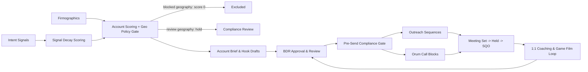

# Outbound BDR Leadership Portfolio


> A working portfolio for a **Manager, Business Development (BDR leadership)** role: how I would coach a team, run the outbound funnel, and use small tools to give reps more time on the phone.

**What's here**
- **Coaching and team design:** a call scorecard with a [fictional worked example](./03-team-and-enablement/05-coaching/worked-scorecard-example.md), a weekly 1:1 agenda, onboarding ramp, and a human-plus-agent ownership and comp framework.
- **Funnel and metrics:** one funnel (Meeting Set → Meeting Held → SQO), a glossary that fixes tier and stage names, and capacity math.
- **Outbound systems:** ICP and account scoring, intent-signal decay, a sequence and call-block design, and stack sync specs.
- **Compliance and global coverage:** channel rules by jurisdiction, a country allow/review/block policy, and calling hours by time zone.
- **Prompt library:** 15 agents, 5 sub-agents and 3 workflow contracts for SDR work.

**Where to start (10 minutes):** the [First 90 Days plan](./05-proof-and-tools/11-first-90-days/role-tailored-execution-plan.md) → the [coaching scorecard and worked example](./03-team-and-enablement/05-coaching/README.md) → the [scoring script and its tests](./01-strategy-and-operations/02-icp-and-account-scoring/README.md).

**What is real and what is not.** The Python is small and runs on fictional sample data (69 tests, all run in CI). No script calls an LLM or a live CRM, sequencer or dialer, and the speed-to-lead MCP server is a proof of concept. Benchmarks and targets in the metrics and onboarding docs are starting points, not measured results. The case studies are anonymized and self-reported. Compliance pages are guardrails, not legal advice, and some items are marked unverified.

---

## Leadership approach
* **People-first coaching:** regular 1:1 call review, live phone-block shadowing, and role-play.
* **Pipeline accountability:** one funnel, measured at Meeting Set → Meeting Held → Sales Qualified Opportunity (SQO).
* **Tools as leverage:** automation that removes rep admin so BDRs spend more time in conversations, with a human reviewing before anything is sent.

---

## Core Operating Systems

| Focus Area | Key Deliverables & Playbooks | Description |
| :-- | :-- | :-- |
| **1. People & Coaching** | [Coaching Scorecards & Frameworks](./03-team-and-enablement/05-coaching/)<br>[Retention & Team Health](./03-team-and-enablement/06-hiring-and-onboarding/retention-and-team-health.md)<br>[Hybrid Team Ownership & Comp](./03-team-and-enablement/05-coaching/hybrid-team-ownership-and-comp.md) | Structured 1:1 call review scorecards, onboarding ramps, and rep development plans. |
| **2. Metrics & Strategy** | [First 90 Days Plan](./05-proof-and-tools/11-first-90-days/role-tailored-execution-plan.md)<br>[Unit Economics & Capacity Math](./01-strategy-and-operations/07-metrics-and-forecasting/unit-economics.md)<br>[System Glossary](./01-strategy-and-operations/glossary.md) | Month 1 phone blocks and team diagnostics, capacity models, and the terminology source of truth. |
| **3. AI Systems & Automation** | [Intent Signal Decay Calculator](./01-strategy-and-operations/03-signals-and-research/decay_calculator.py)<br>[Account Scoring + Geo Gate](./01-strategy-and-operations/02-icp-and-account-scoring/)<br>[AI Workflows (hook pipeline, prompts, speed-to-lead POC)](./02-execution-and-workflows/08-ai-workflows/)<br>[Sync Architecture Spec](./02-execution-and-workflows/12-stack-configuration/sync-architecture.md) | Small runnable Python scripts on sample data: signal time-decay math, account scoring (Tier 1 requires an active decayed signal) with a geo compliance gate, and a templated hook pipeline that applies the same gate before a human review queue. Prompts are ready for an LLM but not yet wired to one; the CRM sync is a design spec. |
| **4. Compliance & Coverage** | [Outbound Compliance Guardrails](./04-compliance-and-coverage/13-compliance/outbound-compliance.md)<br>[Geo Allow/Review/Block Policy](./04-compliance-and-coverage/13-compliance/geo-policy.csv)<br>[Time-Zone & Calling-Hours Model](./04-compliance-and-coverage/14-global-coverage/time-zone-model.md) | Channel rules by jurisdiction (CASL, GDPR/PECR, UWG, CCPA, TCPA/DNCL and more), sanctions and restricted geographies, a pre-send screening gate, and permitted local calling hours. Guardrails, not legal advice. |

---

## 🏗️ End-to-End Outbound Workflow Architecture



Code in this repo covers signal decay, scoring with the geo gate, and templated hook drafts that skip blocked and hold review geographies before the review queue. Denied-party screening, sequencing, dialing, and coaching are documented processes, not code.

---

## 🛠️ Runnable Tooling & Local Quickstart

### 1. Run the Signal Time-Decay Calculator
Computes time-decayed weights for buyer intent signals:
```bash
python3 01-strategy-and-operations/03-signals-and-research/decay_calculator.py
```

### 2. Run the Account Scoring Engine
Scores target accounts against ICP criteria:
```bash
python3 01-strategy-and-operations/02-icp-and-account-scoring/score_accounts.py
```

### 3. Build the Hook Review Queue
Joins sample contacts to accounts and applies the geo policy: blocked contacts are skipped, review contacts are held in `compliance_hold.csv`, and each skip or hold is logged with the reason. Allowed contacts get a templated opening line in `approval_queue.csv` for human review. There's no LLM call, and `enroll` mode is a dry run.
```bash
python3 02-execution-and-workflows/08-ai-workflows/pipeline.py build
```

### 4. Run Automated Tests
```bash
pip install -r requirements.txt
pytest
```
69 tests, all run in CI:
- **Account scoring:** `tests/test_score_accounts.py`, 25 tests. They cover signal decay and the Tier 1 signal requirement, the configurable threshold, tier boundaries, blocked geographies scoring 0, region overrides, and unknown geographies defaulting to review.
- **Hook pipeline:** `tests/test_pipeline.py`, 8 tests. They cover blocked contacts being skipped and logged, review contacts held with a reason, and the dry-run enroll.
- **Speed-to-lead contract:** `tests/test_speed_to_lead_contract.py`, 2 tests. The contract's declared tools must equal the server's registered tools, and the contract paths must exist.
- **Signal decay calculator:** `tests/test_signals.py`, 2 tests.
- **Repo guardrails:** `tests/test_repo_guardrails.py`, 22 tests. They cover the checker itself (see below).
- **Vault sanitizer:** `tests/test_sanitize_synced.py`, 8 tests.
- **Brief-quality check:** `evals/test_prompt_evals.py`, 2 tests. These check length and banned buzzwords on fixed example strings, not on live model output.

### 5. Repo Guardrail Checks
```bash
scripts/check_repo.sh            # or: python3 scripts/check_repo.py
```
Scans the files git tracks (or would track) and prints `path:line` only:
- **a. Content:** heading-only or empty markdown files, and empty folders.
- **b. Leakage:** private-vault leftovers and absolute or home paths.
- **c. Links:** broken relative links and anchors, and README code paths that don't exist.
- **d. Deny-list:** terms from a local, gitignored `.denylist.local` (copy `.denylist.local.example`), matched as whole words in contents and filenames. Skipped cleanly if the file is absent.

CI runs checks a–c (`--checks a,b,c`). Check d runs only on your machine, because the list is deliberately not in the repo.

### 6. Sanitize Synced Files
Prompt-library, tool-profile and raw-source files are synced from a private research vault, which can reintroduce vault-only frontmatter, tags and paths. **Run after any vault sync:**
```bash
python3 scripts/sanitize_synced.py          # fix in place (idempotent)
python3 scripts/sanitize_synced.py --check  # change nothing; exit 1 if anything would change
```
It removes vault-only frontmatter lines and tags, rewrites known vault paths to repo-relative ones, and drops references to the vault's governance file. Anything it has no rule for is listed as `path:line` for a manual fix. The rules are in `scripts/sanitize_synced.py`.

The prompt agents themselves have no automated tests. The speed-to-lead MCP server has a `--selftest` smoke run on mock data and has not been run against a live CRM.

### Roadmap (planned, not built)
- **Denied-party screening API:** call the trade.gov Consolidated Screening List from the pre-send gate. Today this step is a documented process only.
- **Real LLM call in the hook pipeline:** generate opening lines from `prompts/first_line.md` and gate them with the eval checks before the review queue. Today hooks are a fixed template.
- **Host the capacity calculator on GitHub Pages:** move it to a root-level `/docs` folder. Today it is opened locally.

---

## 🧠 GTM Prompt & Agent Library

15 curated prompt agents + 5 shared sub-agents + 3 bounded-autonomy Workflow Contracts, scoped to inbound/outbound SDR leadership specifically (pulled from a broader 53-agent library and filtered down -- no AE/CS/RevOps-engineering material here).

- [`gtm-prompt-library/README.md`](gtm-prompt-library/README.md) -- full index of every agent, sub-agent, skill, and contract in this section
- [`gtm-prompt-library/agents/`](gtm-prompt-library/agents/) -- speed-to-lead SLA enforcement, inbound qualification, sequencing, objection handling, CASL compliance, and more
- [`gtm-prompt-library/sub-agents/`](gtm-prompt-library/sub-agents/) -- ICP fit scoring, trigger-event detection, consent checking, objection mapping, competitive intel lookup
- [`gtm-prompt-library/contracts/`](gtm-prompt-library/contracts/) -- `speed-to-lead-sla`, `inbound-lead-qualifier`, `casl-compliance-gate`
- [`02-execution-and-workflows/08-ai-workflows/speed-to-lead-README.md`](02-execution-and-workflows/08-ai-workflows/speed-to-lead-README.md) -- a working (proof-of-concept) MCP server implementing the speed-to-lead SLA contract

---

## 📁 Repository Structure

* `01-strategy-and-operations/` — Account scoring models, intent signal calculators, capacity math, and system glossary.
* `02-execution-and-workflows/` — AI research pipelines, sequence designs, and Salesforce / Outreach / Orum sync specs.
* `03-team-and-enablement/` — Coaching scorecards, call evaluation rubrics, BDR ramps, and content enablement.
* `04-compliance-and-coverage/` — Outbound compliance guardrails by jurisdiction, sanctions/geo allow-review-block policy, and time-zone and calling-hours models.
* `05-proof-and-tools/` — First 90 Days leadership blueprint, anonymized case studies ([enterprise procurement SaaS](./05-proof-and-tools/case-studies/enterprise-procurement-saas-sdr-function.md), [FP&A SaaS](./05-proof-and-tools/case-studies/fpa-saas-scaling-sdr-org.md); outcomes self-reported), and a browser-based capacity calculator.
* `gtm-prompt-library/` — Curated prompt agents, sub-agents, and workflow contracts (see above).
* `sample-data/` — Fictional accounts, contacts, and history used by the scripts and tests.
* `tests/` — pytest suite run by CI.
